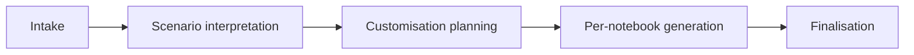

# The Forecasting Agent

The **time-series-forecaster** agent (`.github/agents/`) customises the pipeline for a specific dataset through a **phased, checkpointed workflow**.

| Phase | What happens |
|---|---|
| Intake | Collects dataset, columns, frequency and goal |
| Scenario interpretation | Understands the business forecasting problem |
| Customisation planning | Decides how each notebook must change |
| Per-notebook generation | Produces the adapted notebooks one by one |
| Finalisation | Packages the result for review |

Each phase ends with a **checkpoint**, so you can review and steer before the agent continues.

Example output: `.output/supermarket_net_sales_forecast_20260603/`.

After forecasting, extend the analysis with the [Skills](../skills/index.md).
