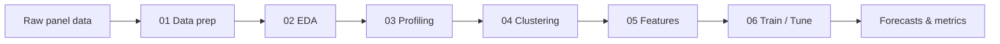

# :chart_with_upwards_trend: Time Series Forecasting Accelerator Agent

**A production-ready pipeline for forecasting multiple time series on Microsoft Fabric and Databricks**, plus an agent that customises it for your dataset.

-   :material-rocket-launch: **Getting Started**

    ---
    Install, check your data shape, and run the six notebooks.

    [:octicons-arrow-right-24: Quick start](getting-started/index.md)

-   :material-pipe: **Pipeline**

    ---
    Data preparation → EDA → profiling → clustering → features → training.

    [:octicons-arrow-right-24: Pipeline](pipeline/index.md)

-   :material-school: **Methodology**

    ---
    Intermittent demand, the Nixtla framework, and how to validate models.

    [:octicons-arrow-right-24: Methodology](methodology/index.md)

-   :material-robot: **Agent & Skills**

    ---
    A phased, checkpointed agent plus 8 pluggable skills: alternative models, DTW clustering and diagnostics.

    [:octicons-arrow-right-24: Skills](skills/index.md)

## What it does

- **Profiles** time series to separate forecastable from problematic patterns
- **Clusters** similar series for efficient modelling
- **Engineers features** — lags, rolling statistics, calendar effects
- **Trains and tunes** ML models (LightGBM / XGBoost) per cluster with `mlforecast`

## Who it is for

| If you are… | The accelerator gives you… |
|---|---|
| New to demand forecasting | A guided, end-to-end reference pipeline and methodology |
| An experienced data scientist | A reusable scaffold you can extend with skills and your own models |
| Delivering for a customer | A Fabric / Databricks-ready starting point that the agent adapts to their data |
