# Validation & Errors

## How to validate

Use **time-based cross-validation** (backtesting): train on the past, test on the following window, roll forward.

```mermaid
gantt
    dateFormat X
    axisFormat %s
    section Fold 1
    Train :0, 8
    Test  :8, 10
    section Fold 2
    Train :0, 10
    Test  :10, 12
    section Fold 3
    Train :0, 12
    Test  :12, 14
```

!!! warning
    Never use random splits — they leak future information.

## Interpreting errors

The pipeline and the benchmarking skills compare models on **MAE, RMSE, WMAPE and ME**:

$$
\text{MAE} = \frac{1}{n}\sum |y_t - \hat y_t|
\qquad
\text{RMSE} = \sqrt{\frac{1}{n}\sum (y_t - \hat y_t)^2}
$$

$$
\text{WMAPE} = \frac{\sum |y_t - \hat y_t|}{\sum |y_t|}
\qquad
\text{ME} = \frac{1}{n}\sum (y_t - \hat y_t)
$$

| Metric | Tells you |
|---|---|
| MAE | Typical error in business units |
| RMSE | Error with large misses penalised more |
| WMAPE | Scale-free error, comparable across series; robust to zeros |
| ME | **Bias** — positive = under-forecasting, negative = over-forecasting |

Always compare against a simple baseline: a model is only useful if it beats it. For a deeper look, use the [Error Analysis](../skills/error-analysis.md) skill.
