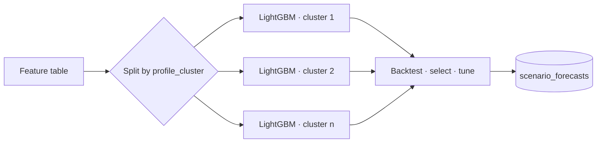

# 06 · Train / Test / Select / Tune

**Purpose:** train, backtest, select and tune ML models per cluster, and produce the scenario forecasts.

## What it does

- Trains **LightGBM** models per `profile_cluster` using **`mlforecast`**
- Backtests on rolling time windows
- Selects and tunes the best configuration
- Writes forecasts (`y_hat_*` columns) to the `<scenario>_forecasts` table

The `<scenario>_forecasts` table is the **baseline** every [alternative-model skill](../skills/index.md) is benchmarked against.

See [Validation & Errors](../methodology/validation.md).
