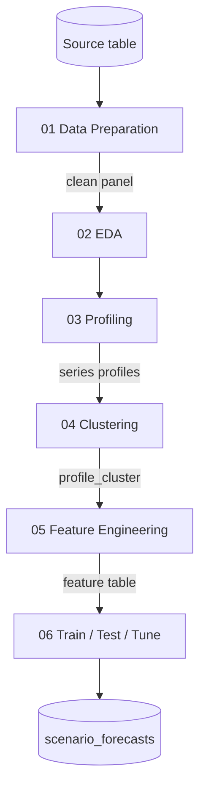

# Pipeline Overview

| # | Notebook | Purpose |
|---|---|---|
| 01 | Data Preparation | Clean and standardise the panel |
| 02 | EDA | Understand trends, seasonality, gaps and outliers |
| 03 | Profiling | Flag intermittent and problematic series |
| 04 | Clustering | Group similar series for modelling |
| 05 | Feature Engineering | Lags, rolling stats, calendar effects |
| 06 | Train / Test / Select / Tune | Per-cluster LightGBM via `mlforecast`; writes `<scenario>_forecasts` |

Templates for the notebooks live in `src/notebooks/templates/`.

!!! info "Independently runnable stages"
    Each notebook reads the table produced by the prior stage and writes its own output table, so every stage can be run and inspected on its own.
