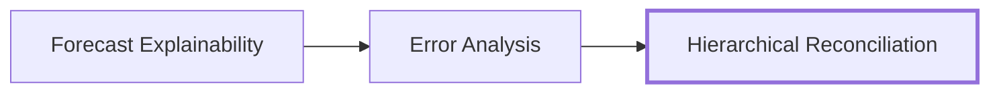

# Hierarchical Reconciliation

**Category:** Diagnostics · **Location:** `.github/skills/` · **Extra dependency:** none beyond `requirements.txt`

## What it does

Rolls base forecasts up a hierarchy and shows **how errors propagate** to aggregate levels.

## When to use it

When decisions are made at aggregate levels (e.g. region or total) as well as per series.

## Inputs & outputs

| | |
|---|---|
| **Reads** | Pipeline outputs: `profile_cluster` and/or `<scenario>_forecasts` |
| **Writes** | Its own results — the core notebooks are never modified |

!!! note
    See the skill's `SKILL.md` in `.github/skills/` for parameters and usage.

[:octicons-arrow-left-24: Back to Skills Overview](index.md)
