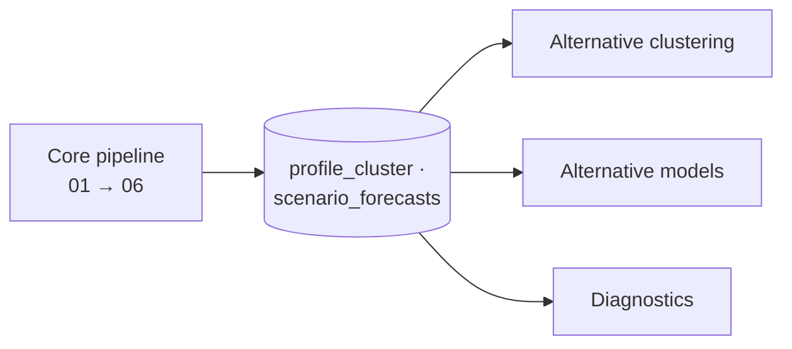
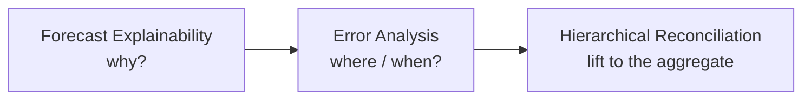

# Skills Overview

Skills are **pluggable, additive extensions**. Each lives in `.github/skills/` as a `SKILL.md` plus a Python module and templates.

!!! info "Read-only by design"
    Skills consume the pipeline outputs — the `profile_cluster` label and the `<scenario>_forecasts` baseline — **without modifying the core notebooks**.

## Alternative clustering

| Skill | What it does |
|---|---|
| [DTW Clustering](clustering-dtw.md) | Clusters regular series by shape with Dynamic Time Warping — drop-in alternative to K-Means in notebook 04 |

## Alternative models (benchmarked vs LightGBM)

Each model runs **twice** — globally over the whole panel and per `profile_cluster` — and is compared on **MAE / RMSE / WMAPE / ME** against the notebook-06 `y_hat_*` baseline, on **identical backtest windows**.

| Skill | Model family | Best for |
|---|---|---|
| [Moving Average](forecasting-moving-average.md) | Rolling / seasonal window average | Smooth, stable, seasonal series |
| [Prophet](forecasting-prophet.md) | Additive trend + seasonality + holidays | Strong seasonality / holiday effects |
| [Intermittent / Croston](forecasting-intermittent.md) | Croston, SBA, TSB, ADIDA, IMAPA | Sparse / lumpy demand |
| [Chronos-2](forecasting-chronos2.md) | Pretrained foundation model (zero-shot) | Cross-learning, no training |

## Diagnostics

| Skill | Question it answers |
|---|---|
| [Forecast Explainability](forecast-explainability.md) | *Why* did the model output this? |
| [Error Analysis](error-analysis.md) | *Where / when* is the forecast wrong? |
| [Hierarchical Reconciliation](hierarchical-reconciliation.md) | How do forecasts roll up, and how do errors propagate? |

### Recommended diagnostic flow

## Extra dependencies

| Skill | Package |
|---|---|
| DTW Clustering | `tslearn>=0.6.3` |
| Moving Average / Intermittent | `statsforecast>=1.7.0` |
| Prophet | `prophet` |
| Chronos-2 | `chronos` / foundation-model runtime |

These are not yet in `requirements.txt`; install them when you use the skill.
